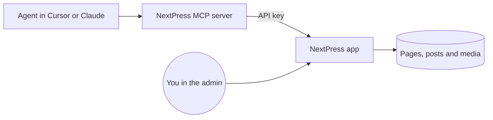

The MCP server, `@nextpress-org/mcp`, lets an AI agent in Cursor or Claude work on your site. The agent can create pages, edit blocks, upload media and write docs. You keep using the admin with your own login, and both of you work on the same content.



## Before you start

You need three things:

1. A running NextPress site.
2. An API key from **Settings**, then **System**, then **API Keys**. The Content editor preset is enough for agent work. See [API keys and permissions](/docs/developers/api-keys).
3. The ID of the site the key belongs to.

The MCP server needs Node.js 20 or later.

## Connect Cursor or Claude

Add the server to your MCP settings. Replace the values in square brackets.

<Tabs>

<Tab title="Cursor">

```json title="MCP settings"
{
  "mcpServers": {
    "nextpress": {
      "command": "npx",
      "args": ["-y", "@nextpress-org/mcp"],
      "env": {
        "NEXTPRESS_URL": "[your site address]",
        "NEXTPRESS_API_KEY": "[your API key]",
        "NEXTPRESS_SITE_ID": "[your site ID]"
      }
    }
  }
}
```

</Tab>

<Tab title="Claude Desktop">

Claude Desktop uses the same settings, in the file `claude_desktop_config.json`.

```json title="claude_desktop_config.json"
{
  "mcpServers": {
    "nextpress": {
      "command": "npx",
      "args": ["-y", "@nextpress-org/mcp"],
      "env": {
        "NEXTPRESS_URL": "[your site address]",
        "NEXTPRESS_API_KEY": "[your API key]",
        "NEXTPRESS_SITE_ID": "[your site ID]"
      }
    }
  }
}
```

</Tab>

</Tabs>

The server reads `NEXTPRESS_URL`, `NEXTPRESS_API_KEY` and `NEXTPRESS_SITE_ID`. Flags such as `--url`, `--api-key` and `--site-id` take priority over them when you run the server from a terminal.

## Rules that keep your content safe

| Rule | What it means |
|---|---|
| Drafts first | New pages and posts are drafts until someone publishes them |
| Versions | Every change is saved against the page's current version |
| No silent overwrites | If you saved in the admin meanwhile, the agent reads the page again instead of overwriting your work |
| Checks before saving | A change that would break the page is not saved, and the reply says why |
| Undo | The agent can list a page's earlier versions and put one back |
| Publishing | The agent publishes only when you ask it to |
| Permissions | Give the key the smallest set of permissions that works |

## How an agent builds a page

Start the agent with the `build_page` prompt. In Claude Code, it appears as `/mcp__nextpress__build_page`. It carries the page design guide and the steps that work well.

<Steps>

<Step title="Learn the site">

The agent reads the site's theme and settings, and lists its pages, media and shared header and footer parts. It links only to pages that exist.

</Step>

<Step title="Make a draft">

The agent creates a draft page with a title, then reads the page's outline.

</Step>

<Step title="Build one section at a time">

The agent adds one section per change, such as the header, then the hero, then the features. A change that is refused says why, and the agent sends it again.

</Step>

<Step title="Check the page">

The agent checks the page for problems, and fixes the phone-layout warnings that have an obvious fix.

</Step>

<Step title="Preview and leave it as a draft">

The agent gives you a preview link. The page stays a draft until you ask for it to be published.

</Step>

</Steps>

To change one block, use the `edit_block` prompt. It tells the agent to stay inside that block.

## How an agent writes docs

Start the agent with the `write_docs` prompt and the topic of the docs. The prompt carries the docs writing guide and the MDX rules for every component.

<Steps>

<Step title="Find or make the docs">

The agent lists the site's docs. If the site has none, it makes one.

</Step>

<Step title="Read the navigation">

The agent reads the tree of pages, so every link points at a page that exists.

</Step>

<Step title="Add pages and groups">

The agent adds the pages and groups, then moves and orders them.

</Step>

<Step title="Write each page">

The agent reads a page's MDX and its version, then saves the whole text with that version. A broken MDX is refused with the line to fix.

</Step>

<Step title="Leave the docs as drafts">

The pages stay drafts until you ask for them to be published.

</Step>

</Steps>

<Accordion title="The agent says the page changed somewhere else">

Someone saved the page in the admin while the agent was working. Nothing was overwritten. The agent reads the page again and sends its change again on the new version.

</Accordion>

<Accordion title="Where do the server's errors go?">

Problems the server could not recover from are written to the terminal's error output as one line of JSON each. The line names the tool, the page and the cause. Read the logs there when a request fails.

</Accordion>
