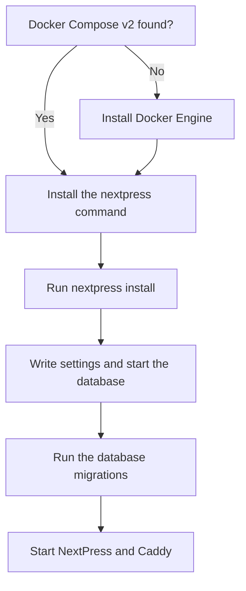

There are two ways to run NextPress. On a server, the installer sets everything up with Docker. On your own computer, you can run it from the source code, with a database that is built in, so you do not need Docker.

<Tabs>

<Tab title="On a server">

You need a Linux server with `curl` installed. For HTTPS on your own domain, first point the domain at the server with an A record that holds the server's IP address.

```bash title="Install"
curl -fsSL https://raw.githubusercontent.com/nextpress-ai/nextpress/main/install.sh | bash
```

The installer checks for Docker Compose v2. If it is missing, the installer installs Docker Engine with Docker's official installer. It then puts the `nextpress` command in `/usr/local/bin`, checks that the command works, and runs `nextpress install` for you.

</Tab>

<Tab title="On your computer">

You need Git, Node.js 24 (the version the official image runs on) and pnpm.

```bash title="Run from source"
git clone https://github.com/nextpress-ai/nextpress nextpress
cd nextpress
pnpm install
pnpm dev
```

This starts NextPress for local development and trying it out. It uses PGlite, a PostgreSQL database that runs inside the app. When it has started, open `http://localhost:5000`.

</Tab>

</Tabs>

## How the installer works



## What nextpress install does

<Steps>

<Step title="Get the setup files">

Find the production setup file, `docker-compose.prod.yml`.

</Step>

<Step title="Write your settings">

Create `.env` with new secrets, and the first Caddy config, which is the web server's settings.

</Step>

<Step title="Start the database">

Download the images and start PostgreSQL.

</Step>

<Step title="Prepare the database">

Run the database migrations that come with the app image.

</Step>

<Step title="Start NextPress">

Start the app and Caddy. Caddy serves your sites and gets their HTTPS certificates.

</Step>

</Steps>

## Where it lives

Everything goes in `/opt/nextpress`. To use another folder, pass `--install-dir` (or `-d`) before the command.

```bash title="Install into your home folder"
nextpress --install-dir "$HOME/nextpress" install
```

<FileTree>

- opt/nextpress/
  - **docker-compose.prod.yml**
  - .env # your settings and secrets
  - nextpress.config.json # the schema version of this release
  - caddy_config/
    - Caddyfile
  - backups/ # database copies made before upgrades
  - update/ # requests from the dashboard's one-click updates
  - update-logs/ # the logs of those updates

</FileTree>

## Install a particular version

Versions are tagged like `beta-v1.0.2`. Without `--version`, the installer uses the newest version.

```bash title="Install a version"
nextpress install --version beta-v1.0.2
```

The app image is [husseinkizz/nextpress](https://hub.docker.com/r/husseinkizz/nextpress) on Docker Hub.

## Finish in the browser

Open your server's address. The setup wizard, titled Welcome, asks for these fields.

| Field | What to enter |
|---|---|
| Site name | The name of your site, for example "Acme" |
| Domain | Your domain, such as `example.com`. Tick **Use local** to run on this machine only, with no DNS or HTTPS setup |
| Admin email | The email you sign in with |
| Password | At least 8 characters, with one uppercase letter, one lowercase letter and one number. Type it again in **Confirm password** |

After the wizard, sign in. Then carry on with [Your first page](/docs/getting-started/first-page).

## If something goes wrong

<Accordion title="The installer stops because Docker is missing">

This happens when `NEXTPRESS_SKIP_DOCKER_INSTALL=1` is set. The installer then stops instead of installing Docker for you. Install Docker Engine with its Compose plugin, then run the installer again.

</Accordion>

<Accordion title="How do I know it is running?">

Run `nextpress status` to see each service. Or open `/api/health` on your server. It answers once NextPress is ready.

</Accordion>

<Accordion title="My domain does not open">

Check that the domain's A record points at the server's IP address. Caddy can only get a certificate once it does. The certificate usually arrives within a minute after the record works.

</Accordion>
