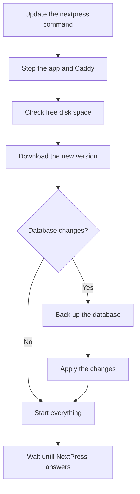

An upgrade keeps your content. When a new version changes the database, NextPress makes a backup of the database first, and only then makes the change.

<Tabs>

<Tab title="From the dashboard">

When a new version is out, owners and admins of the main site see **Update available** in the sidebar. Press **Update now**. It shows what will happen, asks for your password, then follows the update through the restart and opens What's New.

The site stays online while the new version downloads. If the upgrade fails, the previous version is put back. The dashboard then says what went wrong and shows the one command to run by hand.

</Tab>

<Tab title="From the command line">

On the server, run:

```bash title="Upgrade to the latest version"
nextpress upgrade
```

To move to one particular version, add `--version`:

```bash title="Upgrade to a version"
nextpress upgrade --version beta-v1.0.2
```

</Tab>

</Tabs>

## What an upgrade does



Only one upgrade runs at a time. If you start one by hand while the dashboard is updating, the second one stops with "Another NextPress update is already running on this server."

## Turn dashboard updates on or off

Dashboard updates need a small helper on the server. `nextpress install` and `nextpress upgrade` turn it on when the server runs systemd and the command runs as root. You can switch it on or off yourself:

```bash title="Turn the helper on or off"
sudo nextpress update-helper on
sudo nextpress update-helper off
nextpress update-helper status
```

Without the helper, the dashboard tells you and shows the command to run instead.

## Disk space

An upgrade needs room for the new version, a backup and the database's own work:

| Where | Free space needed |
|---|---|
| The install folder (`/opt/nextpress` by default) | At least 1 GB |
| Docker's data folder (usually `/var/lib/docker`) | At least 2 GB |

Before it checks the disk, the upgrade removes unused Docker layers and old database backups. It keeps only the three newest backups.

## When versions are too far apart

Each version says which database version it can upgrade from. If your install is older than that, the upgrade stops before it changes anything:

```text title="Error message"
Error: Schema upgrade expects incompatible-test but this install is on 2026.04.28.002.
```

Upgrade to an in-between version first. If you do not need to keep the old data, you can start the database over instead:

```bash title="Override the database"
nextpress upgrade --version beta-v1.0.2 --override
```

<Callout type="danger" title="Override deletes your database">

Override makes a backup of the database, then clears the PostgreSQL data and starts fresh. It does not intentionally remove uploads or Caddy data. Use it only when you are sure. Add `--yes` only in scripts that have already asked a person.

</Callout>

## Backups

Backups are database copies made with `pg_dump`. They are saved in the `backups` folder of the install, as `nextpress-db-YYYYMMDDHHMMSS.sql`. The upgrade stops if it cannot make a backup.

NextPress does not restore a backup for you. Putting a backup back is a manual job. See [Back up and move](/docs/self-hosting/back-up-and-move) for the other copies you can make.
