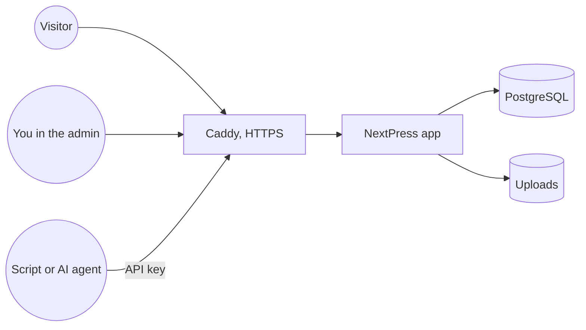

NextPress is a content system you run on your own server. You design pages from blocks, write blog posts and docs, and publish them on your own domains. It works like WordPress where that helps: it has WordPress-compatible REST endpoints and an import from WordPress. It is written in TypeScript from end to end.

<Callout type="note" title="NextPress is in beta">

Features change between releases. After each update, the admin shows what is new.

</Callout>

## What you get

- **Pages** built from blocks, with desktop, tablet and mobile views. Preview and the live site use the same renderer, so visitors see what you saw in preview.
- **Blogs** with posts, and post blocks such as Post List, Comments and Author Box.
- **Docs** with a sidebar, search, and components for code, steps, tabs and diagrams.
- **Several sites** in one install. Each site has its own pages, posts, media, settings and theme, and its own domain with HTTPS set up for you.
- **An AI assistant** in the page editor that uses your own AI service.
- **An SDK and an MCP server**, so scripts and AI agents can work on your content with API keys.

## How it fits together

On a server, NextPress runs as three services: the app, a PostgreSQL database, and Caddy, the web server. Caddy serves your sites and gets their HTTPS certificates. The app reads and writes the database and your uploaded files.

## Start here

<Cards cols="2">

<Card title="Install" href="/docs/getting-started/install">

Put NextPress on a server with one command, or run it on your computer.

</Card>

<Card title="Your first page" href="/docs/getting-started/first-page">

Go from a fresh install to a published page in a few minutes.

</Card>

<Card title="The page builder" href="/docs/pages-and-content/page-builder">

Blocks, device previews, settings and publishing.

</Card>

<Card title="Writing docs" href="/docs/pages-and-content/writing-docs">

Build a docs with a sidebar, search and components for technical writing.

</Card>

<Card title="Set up AI" href="/docs/ai-assistant/set-up-ai">

Connect your AI service and let the assistant help you build pages.

</Card>

<Card title="MCP server" href="/docs/developers/mcp-server">

Let Cursor or Claude build and edit your pages and docs.

</Card>

</Cards>
