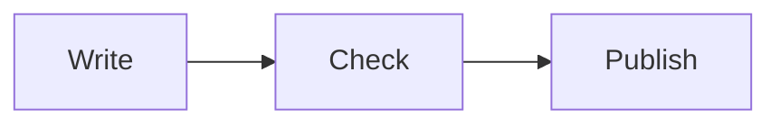

A docs is a set of pages on your site with its own header, sidebar and search. You write each page in the docs editor. The editor shows the real docs frame, and it offers only the blocks that docs pages need.

## Set up docs

Set up a docs once. Then you only write its pages.

<Steps>

<Step title="Name your docs">

Enter a name, such as "Acme Docs". Add a logo if you want one.

</Step>

<Step title="Choose where it lives">

Pick **On this site** to put the docs under an address on your site, such as `example.com/docs`. You can change the part after the domain.

Pick **On its own address** to give the docs its own domain, such as `docs.example.com`. Point that domain at your server first, as you would for any site.

</Step>

<Step title="Choose what it has">

Switch on the features you want: **Search**, **Sidebar**, **On this page**, **Previous / next** and **Copy page**. They are all on by default. You can change them later in the editor.

</Step>

</Steps>

Press **Create docs**. The docs home page opens in the docs editor, empty and ready to write.

<Callout type="note" title="Until the address is ready">

When a docs uses its own address, the docs open from the admin preview until the address is ready.

</Callout>

## The docs editor

The canvas shows the real docs frame: the header, the sidebar, the page, and the **On this page** list and previous and next links, all as visitors see them. Only the page's content area takes blocks. Click the header or the sidebar to open its settings in the right panel.

| Part | What it is for |
|---|---|
| Blocks panel (left) | The docs blocks, grouped and searchable |
| Canvas (middle) | The real docs frame. Drop blocks into the content area |
| **Page** tab (right) | The title, description, address and status of the page you are on. Its **On this page**, **Previous / next** and **Copy page** switches, and **Hide from sidebar** |
| **Docs** tab (right) | The settings of the whole docs: header, navigation, search, features and address |
| **Block** tab (right) | The settings of the block you picked. It appears when a block is picked |

The **Docs** tab has these sections:

- **Header:** the logo for light and dark mode, the title, up to six links, one button such as "Get started", and the light and dark switch.
- **Navigation:** the sidebar as a tree of groups and pages. See [Navigation](#navigation) below.
- **Search:** on or off, the placeholder text, and what it covers. Search covers only the pages of this docs.
- **Features:** the switches from setup.
- **Address:** where the docs lives.

### Visual and MDX

The top of the editor has two views of the same page. **Visual** shows the page as blocks. **MDX** shows the same page as MDX text, with line numbers. Switching back to Visual reads the MDX into blocks again.

If the MDX has a mistake, the MDX view shows the line with the problem. Visual waits until you fix it. Both views edit the one saved page.

## Navigation

The sidebar is a tree of groups and pages. Build it from the **Navigation** section of the **Docs** tab.

- Press **+ Page** to add a page, or **+ Group** to add a group. Adding a page asks only for its title.
- Open a row's menu for **Rename**, **Move up**, **Move down**, **Make sub-page**, **Move out**, **Hide** and **Delete**. Delete asks you to confirm.
- Drag rows inside the list to change their order. Pages are never added by dragging on the canvas.
- A group holds pages, but it has no text of its own. Write the text in a page inside the group.
- The docs home page stays at the top of the sidebar. It cannot be hidden, made into a group, or moved.
- You cannot delete a page that still has pages under it. Move or delete those pages first.

## Write a page

Press **Enter** to start a new paragraph. Type a shortcut at the start of a line to change its kind:

| Type | To get |
|---|---|
| `## ` | A heading |
| `- ` | A bulleted list |
| `1. ` | A numbered list |
| `[] ` | A checklist |
| `> ` | A quote |
| three backticks | A code block |

Press `/` to open the block menu, then type a name to search it. You can also drag a block from the Blocks panel into the content area.

The docs editor offers only docs blocks. They are grouped into writing, callouts, code, structure, reference and media. Each one has an example in the Components section below.

## Components

Each component is one MDX element. Write it in the MDX view, or add it as a block in the Visual view. The examples below are MDX.

<Callout type="warning" title="Keep tags on their own lines">

Put every component tag on its own line. Leave one blank line after an opening tag and one blank line before a closing tag. Put attribute values in double quotes. Do not write HTML, imports or JavaScript.

</Callout>

### Callouts

A callout draws the reader's eye to a note, a tip, a warning, a danger or a success.

````mdx
<Callout type="warning" title="Back up first">

Export the docs before you delete a page.

</Callout>
````

The `type` is `note`, `tip`, `warning`, `danger` or `success`. The `title` is optional. A type that is not in this list shows as a note.

### Steps

Steps show a task in order. Give each step a title that names the action.

````mdx
<Steps>

<Step title="Install">

Run the installer and wait for it to finish.

</Step>

<Step title="Sign in">

Open the dashboard and sign in with your account.

</Step>

</Steps>
````

### Tabs

Tabs show one option of several, such as an operating system. Each `Tab` has a `title` for its label.

````mdx
<Tabs>

<Tab title="macOS">

Text for macOS.

</Tab>

<Tab title="Linux">

Text for Linux.

</Tab>

</Tabs>
````

### CodeGroup

A CodeGroup shows the same command for several tools. Each code block inside becomes one tab. Its label is the block's `title`.

````mdx
<CodeGroup>

```sh title="npm"
npm install @nextpress-org/sdk
```

```sh title="pnpm"
pnpm add @nextpress-org/sdk
```

</CodeGroup>
````

### Cards

Cards link to other pages. Use them on overview pages. Set `cols` to how many cards sit side by side on a desktop, from 1 to 4. Phones always show one card per row.

````mdx
<Cards cols="2">

<Card title="Install" href="/docs/getting-started/install">

Get NextPress running.

</Card>

</Cards>
````

### Accordion

An accordion hides an answer until the reader opens it. Use it for FAQs and troubleshooting.

````mdx
<Accordion title="Can I use my own domain?">

Yes. Add the domain in the settings, then point its DNS record at the site.

</Accordion>
````

### FileTree

A FileTree shows a folder layout. Indent a line to put it inside the folder above. A `#` comment after a name explains it.

````mdx
<FileTree>

- my-app/
  - src/
    - app.ts # the entry point
  - package.json

</FileTree>
````

### Param

A Param documents one option, a field or an argument, with its type and default. Its text says what the option does.

````mdx
<Param name="limit" type="number" default="20">

How many items to show, from 1 to 100.

</Param>
````

### Example

An Example shows code beside its result. The first code block is the code, and the text after it is the result.

````mdx
<Example layout="side">

```ts
const total = 2 + 3
```

The result is 5.

</Example>
````

`layout` is `side` (the default, code and result side by side on wide screens) or `stacked`. Phones always stack them.

### Diagrams

A diagram is a code block whose language is `mermaid`. This one shows the steps of writing a page:



Keep a diagram to about eight boxes. Label each arrow in plain words, and describe the flow in the text around it.

### Code blocks

Name the language right after the opening fence, so the code is coloured. The options follow it on the same line: the lines to mark, a title, and then `showLineNumbers`.

````md
```ts {2,4-6} title="app.ts" showLineNumbers
const name = "NextPress"
const greeting = "Hello, " + name
const shout = greeting.toUpperCase()
```
````

Lines 2, 4, 5 and 6 are marked, and the file name shows above the code.

### Keys and badges

`Kbd` shows one key on the keyboard. `Badge` shows a short label. A `tone` of `accent`, `neutral`, `success`, `warning` or `danger` sets its colour, and a `look` of `soft`, `outline` or `solid` sets its style.

````mdx
Press <Kbd>Ctrl</Kbd> and <Kbd>K</Kbd> to search.

This feature is <Badge tone="success" look="soft">New</Badge>.
````

### Release notes

An `Update` is one release note. Its `label` is the version or the date, and its `description` is one sentence. Put the newest release first.

````mdx
<Update label="0.4.0" description="Docs pages from the SDK and MCP">

Agents can list, add, move and write docs pages.

</Update>
````

### Tables

Use a table to compare values side by side. Each row sits on one line.

```md
| Setting | Default | What it does |
|---|---|---|
| title | the docs name | The name shown in the header |
| search | on | Whether the search button shows |
```

## Export, import and agents

The **Docs** screen lists your docs. Each docs has three buttons: **Open editor**, **New docs page** and **Export docs**.

**Export docs** saves the whole docs as one page file, with its tree of pages and groups. To bring it into another site, use **Import page** on the Pages screen. Import makes a draft page from the file. See [Move pages between sites](/docs/pages-and-content/move-pages).

Agents can write docs too. They use the SDK or the MCP server, and they follow the same checks as the editor. See [MCP server](/docs/developers/mcp-server).
