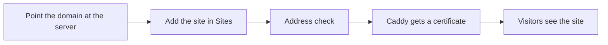

One NextPress install can run several sites. Each site has its own pages, posts, media, settings and theme, and its own address. Visitors see the site whose address they typed.



## Add a site

Before you add a site, point its domain at your server. Create an A record that holds the server's IP address. For a main domain such as `example.com`, add `www` too if you want it.

<Steps>

<Step title="Open Sites">

In the admin, open **Sites**, then press **Add site**.

</Step>

<Step title="Give the site an address">

Give the site a name and its address, such as `shop.example.com`. The address check shows when the domain points at your server.

</Step>

<Step title="Wait for the certificate">

NextPress adds the address to the web server. Caddy then gets a certificate for it, which usually takes about a minute.

</Step>

<Step title="Choose the site you work on">

Pick the site you are working on at the top of the admin. Pages, posts, media, settings and the theme belong to that site.

</Step>

</Steps>

## Try a second site on your computer

On your own computer, you do not need DNS or HTTPS. Browsers send any address that ends in `.localhost` to your own machine. Give a second site an address such as this:

```text title="Local address for a second site"
http://site2.localhost:5000
```

<Callout type="note" title="Unknown addresses">

An address that no site uses shows the default site.

</Callout>

## Keys and roles stay per site

Each API key belongs to one site. A key cannot work on another site. See [API keys and permissions](/docs/developers/api-keys).

A person's role is also set per site. The same person can have one role on one site and another role on a different site. See [People and roles](/docs/people-and-roles).

## If the domain does not open

<Accordion title="My new site's address does not open">

Check that the domain's A record points at the server's IP address. Caddy can only get a certificate once it does. The certificate usually arrives within a minute after the record works.

</Accordion>

<Accordion title="A visitor sees the default site instead of mine">

The address the visitor typed does not match any site. Check the spelling of the site's address in **Sites**.

</Accordion>
